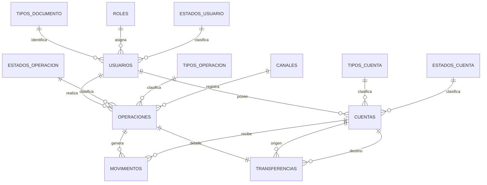

# Proyecto Integrador — Simulador Bancario Web

Sistema web multi-módulo que simula las operaciones fundamentales de una entidad bancaria comercial, integrado sobre una base de datos centralizada en MySQL (diseñada estrictamente en **Tercera Forma Normal - 3NF**), un backend transaccional en **Node.js + Express** y una interfaz moderna con estética *obsidian black* en **React 19, Tailwind CSS v4 y Radix UI**.

---

## Integrantes
* **Jairo Andrés Pai Guanga** — Desarrollador Full-Stack & Arquitectura de Software
* **Melisa Pinilla** — Documentación Técnica, Casos de Prueba y Manual de Usuario
* **Isabella Caviedes** — Diseño Funcional, Presentación Ejecutiva y Validación de Procesos

---

## Stack Tecnológico

### Backend
* **Node.js** (v24+)
* **Express.js** (Servidor HTTP y API REST)
* **mysql2/promise** (Pool de conexiones y transacciones ACID en MySQL con bloqueo `FOR UPDATE`)
* **express-session** (Manejo de sesiones autenticadas HTTP-Only con control estricto de roles)
* **bcryptjs** (Cifrado unidireccional de contraseñas y PINs con 10 salt rounds)
* **dotenv** (Gestión de variables de entorno seguras)

### Base de Datos
* **MySQL / MariaDB** (Motor InnoDB para garantizar propiedades ACID de consistencia transaccional y claves foráneas).
* **Diseño en Tercera Forma Normal (3NF)**: 13 tablas relacionales normalizadas que eliminan anomalías de redundancia y actualización.

### Frontend
* **React 19** con **Vite 8**
* **Tailwind CSS v4** (Sistema de diseño *Obsidian Black* con azul zafiro y acentos cyan/esmeralda)
* **Radix UI & Lucide Icons** (Modales, formularios, diálogos accesibles)
* **Sonner** (Notificaciones toast en tiempo real)
* **Diseño Responsivo Total**: Adaptado para PC (Desktop), Tablet y Celular (Mobile First con barra de navegación inferior táctil).

---

## Modelo Entidad-Relación (Tercera Forma Normal - 3NF)



---

## Arquitectura del Sistema (3 Módulos Integrados)

El sistema opera sobre una **única base de datos centralizada**, de modo que cualquier transacción realizada desde cualquiera de los canales se refleja de forma instantánea en los demás:

### 1. Módulo de Cliente — Banca Virtual
* Inicio de sesión seguro con correo o documento + contraseña.
* Consulta de saldo en vivo, número de cuenta y tipo de cuenta.
* Historial de movimientos con fecha, tipo de operación, canal, valor (+ / -) y saldo resultante.
* **Transferencias electrónicas inmediatas** hacia otras cuentas registradas en el banco (con bloqueo de saldo, validación de cuenta activa y emisión de comprobante digital).
* **Simulador Tributario Colombiano (4x1.000 - GMF):** Desglose del impuesto con opción de cuenta exenta (Art. 879 E.T.) y switch para simular cuenta gravada.
* Modificación de información de perfil (teléfono) y cambio de contraseña con validación de clave actual en `bcrypt`.

### 2. Módulo de Cajero Automático Virtual ATM
* Simulación visual de terminal de autoservicio de cajero físico con pantalla LCD bancaria.
* Identificación por número de cuenta y PIN de 4 dígitos.
* Consulta de saldo en pantalla.
* Retiro rápido de efectivo ($50.000, $100.000, **$200.000 - Caso clave del docente**, $400.000 y monto personalizado) con validación de saldo suficiente y múltiplos de $10.000 COP.
* Emisión de **Voucher / Recibo térmico digital** con número de aprobación, fecha, cajero `ATM-BOG-004` y nuevo saldo.
* Visualización en pantalla de los últimos 5 movimientos.

### 3. Módulo Administrativo del Banco
* Consola central de backoffice bancario para funcionarios y administradores.
* **Dashboard con los 4 indicadores obligatorios (Pág. 3 del PDF):**
  1. Cantidad total de clientes registrados.
  2. Cantidad de cuentas bancarias activas.
  3. Cantidad de clientes o cuentas bloqueadas.
  4. Suma total de los saldos almacenados en bóveda.
* Registro y creación de nuevos clientes con asignación automática de cuenta bancaria y saldo inicial.
* Búsqueda en tiempo real de clientes por documento, nombre o número de cuenta.
* **Habilitación y bloqueo de clientes** (estados: `ACTIVO`, `INACTIVO`, `BLOQUEADO`). Si se bloquea a un cliente, sus cuentas quedan suspendidas inmediatamente en MySQL y se rechazan retiros y transferencias en todos los canales.
* **Ventanilla de consignación en efectivo** con comprobante oficial de caja (flujo clave del profesor para inyectar $100.000 COP).
* Auditoría general inmutable de todos los movimientos del banco.

---

## Requisitos Previos
* **Node.js** (v18 o superior) y **npm**.
* **MySQL Server** o **XAMPP / MariaDB** ejecutándose en el puerto `3306`.

---

## Instrucciones de Instalación y Ejecución

### 1. Clonar el repositorio
```bash
git clone https://github.com/pai12op/BANCO.git
cd BANCO
```

### 2. Configurar la Base de Datos MySQL
1. Abrir phpMyAdmin (`http://localhost/phpmyadmin`) o la consola de MySQL.
2. Importar el script `database.sql` ubicado en la raíz del proyecto:
   ```bash
   mysql -u root -p < database.sql
   ```
   *(El script crea la base de datos `simulador_bancario`, sus 13 tablas en 3NF con claves foráneas, restricciones y los datos iniciales de prueba).*

### 3. Configurar variables de entorno (`.env`)
Crear un archivo `.env` en la raíz con sus credenciales locales:
```env
PORT=3050
DB_HOST=localhost
DB_USER=root
DB_PASSWORD=
DB_NAME=simulador_bancario
DB_PORT=3306
SESSION_SECRET=banco_andino_super_secret_session_key_2026
```

### 4. Instalar dependencias del Backend y Frontend
```bash
# En la raíz (Backend Express)
npm install

# En la carpeta frontend (React + Tailwind)
cd frontend
npm install
cd ..
```

### 5. Iniciar los Servidores

**Terminal 1 — Backend Express:**
```bash
node server.js
# Servidor escuchando en: http://localhost:3050
```

**Terminal 2 — Frontend React (Vite):**
```bash
cd frontend
npm run dev
# Servidor de interfaz listo en: http://localhost:3051
```

---

## Usuarios y Credenciales de Prueba (Seed Data)

| Módulo | Usuario / Cuenta | Clave / PIN | Rol / Estado | Saldo Inicial |
| :--- | :--- | :--- | :---: | :---: |
| **Admin** | `admin@banco.com` | `Banco123*` | Administrador (Activo) | N/A |
| **Banca / Cliente 1** | `andres@cliente.com` (C.C. 1001234567) | `Banco123*` | Cliente (Activo) | Cuenta Ahorros `400110203040` — **$1.000.000 COP** |
| **Banca / Cliente 2** | `melisa@cliente.com` (C.C. 1002345678) | `Banco123*` | Cliente (Activo) | Cuenta Corriente `500190807060` — **$2.500.000 COP** |
| **Banca / Cliente 3** | `isabella@cliente.com` (C.C. 1004567890) | `Banco123*` | Cliente (Activo) | Cuenta Ahorros `400122334455` — **$1.800.000 COP** |
| **Cajero ATM** | No. Cuenta: `400110203040` | PIN: `1234` | Cliente Activo | Saldo disponible para retiro |
.
